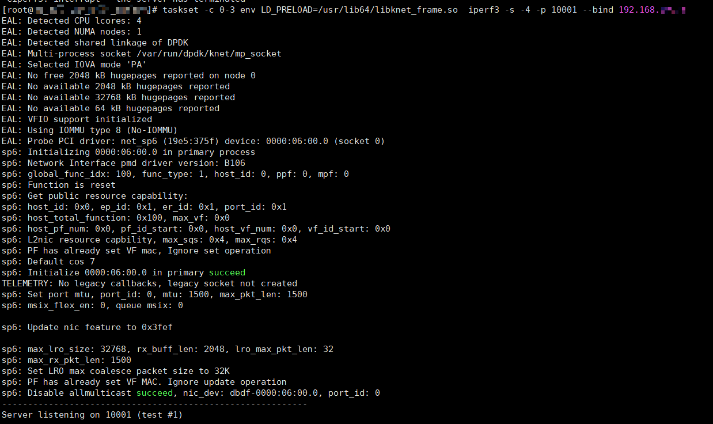
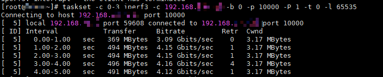

# 内核流量转发功能

本文档介绍内核流量转发功能。内核流量转发功能用于解决业务在使用非K-NET协议栈线程时的建链问题，适用于希望打通K-NET与内核态混合部署的用户。

## 功能描述

提供内核流量转发功能开关，支持通过用户态协议栈对内核态流量进行转发，支持内核态与K-NET应用的同时使能。主要适用于网卡不支持硬件流量分叉场景。

> [!NOTICE]须知
>K-NET流转发使能侧的MTU需保证不高于对端网卡及链路上交换机的MTU（Maximum Transmission Unit，最大传输单元）。

## 使用示例

本章示例以iPerf3单进程为例，说明如何使用内核流量转发功能。

### 前提条件

本功能需要保证内核协议栈和使用<term>K-NET</term>的进程使用不同的端口区间，否则内核态进程可能收不到流量。请参考[共线程功能的步骤4](./cothread.md)进行配置，保证内核协议栈与K-NET端口范围不交叉。

内核流量转发旨在提供软件级的流量分流功能，能够在用户态劫持后运行同一个网口的内核进程，用户需要配置/etc/knet/knet_comm.conf的“bifur_enable”配置项，2代表开启，0代表关闭。

```json
{
    "hw_offload": {
        "bifur_enable": 2
    }
}
```

### 操作步骤

1. 开启后用户态劫持启动。

    ```bash
    taskset -c 0-3 env LD_PRELOAD=/usr/lib64/libknet_frame.so iperf3 -s -4 -p 10001 --bind 192.168.*.*
    ```

    > [!NOTE]说明
    >- taskset -c 0-3表示对CPU核心0-3绑核，指定进程只能在这些CPU核心上运行，用户根据实际场景替换。
    >- /usr/lib64/libknet_frame.so为K-NET共享库默认安装路径，若不同需根据实际场景替换。

    

2. 启动内核态进程，该内核进程流量由用户态进程转发处理。

    ```bash
    taskset -c 0-4 iperf3 -s -4 -p 10000 --bind 192.168.*.*
    ```

    > [!NOTE]说明
    > 此IP地址与用户态IP地址相同，端口不同。

    

    启动成功后即可与内核进程建立连接，发送流量。

3. 客户端主机中运行iPerf3与内核进程进行测试。

    ```bash
    taskset -c 32-63  iperf3 -c 192.168.*.* -b 0 -p 10000 -P 1 -t 0 -l 65535
    ```

    内核进程建链并打流成功。

    
