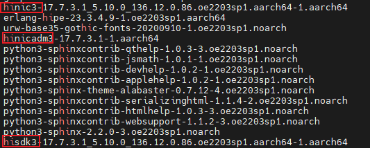
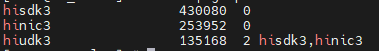
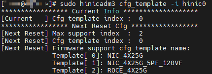
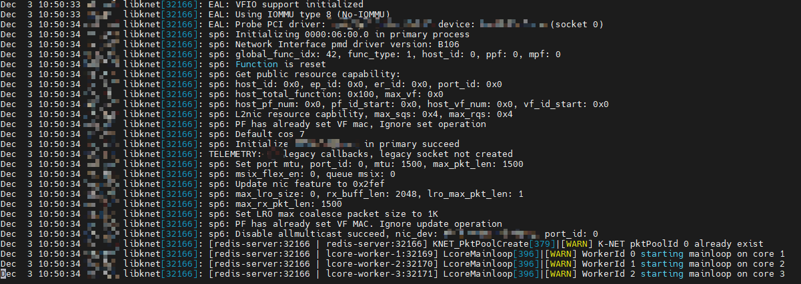
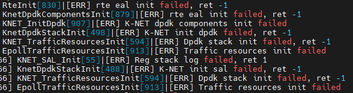
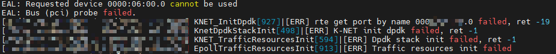
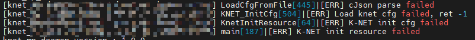

# 日常运维

介绍K-NET的日常运维方法，涵盖网卡检查、环境配置检查及日志检查事项，包括驱动加载确认、网卡模板检查、DPDK（Data Plane Development Kit，数据平面开发套件）接管与大页检查及熵池检查，以及常见ERR日志的定位与处理。阅读本指南后，您将能完成K-NET日常巡检并及早发现运行异常。

## 网卡检查

1. 检测网卡驱动是否存在。

    ```bash
    rpm -qa | grep hi
    ```

    检查显示结果，确保hinic3、hisdk3、hinicadm3等网卡驱动已安装。

    

    若不存在请参考[《华为 SP600 智能网卡 用户指南》](https://support.huawei.com/enterprise/zh/doc/EDOC1100309168/426cffd9?idPath=23710424|251364417|9856629|253287505)进行驱动的安装。

2. 网卡驱动存在后还需要进一步确认驱动已经加载到系统。

    检测驱动是否已加载。

    ```bash
    lsmod | grep hi
    ```

    正常情况是包含hinic3、hisdk3、hiudk3等网卡驱动。结果如下：

    

    若驱动不存在则执行如下命令加载驱动：

    ```bash
    modprobe hiudk3
    modprobe hisdk3
    modprobe hinic3
    ```

3. 查看网卡模板。

    ```bash
    hinicadm3 cfg_template -i hinic0
    ```

    

    “Current Info”字段中的“Cfg template index”显示为“0”表示模板正确，如果为其他值，请按照以下操作修改并重启：

    1. 切换网卡为模板0。

        ```bash
        hinicadm3 cfg_template -i hinic0 -s 0
        ```

    2. 重启。

        ```bash
        reboot
        ```

        重启后请再次执行命令查看当前网卡模板。
        > [!NOTE]说明
        > 若使用流量分叉功能，需将模板切换为ROCE_2X100G_UN_ADAP。

## 环境配置检查

1. 检查DPDK接管状态。

    ```bash
    dpdk-devbind.py -s
    ```

    查询结果以SP670网卡VF（Virtual Function，虚拟功能）为例，如下所示：

    ```output
    Network devices using DPDK-compatible driver
    ============================================
    0000:06:00.0 'Device 375f' drv=vfio-pci unused=hisdk3
    Network devices using kernel driver
    ===================================
    0000:01:00.0 'Virtio network device 1041' if=enp1s0 drv=virtio-pci unused=virtio_pci,vfio-pci *Active*
    No 'Baseband' devices detected
    ==============================
    No 'Crypto' devices detected
    ============================
    No 'DMA' devices detected
    =========================
    No 'Eventdev' devices detected
    ==============================
    No 'Mempool' devices detected
    =============================
    No 'Compress' devices detected
    ==============================
    No 'Misc (rawdev)' devices detected
    ===================================
    No 'Regex' devices detected
    ===========================
    ```

    确认检查结果：

    - 若SP670网卡查询信息出现在“DPDK-compatible driver”一栏，则检测通过。
    - 若上述查询SP670网卡并未出现在“DPDK-compatible driver”一栏，参考[配置大页内存](../feature_guide/environment_configuration.md#配置大页内存)接管网卡部分继续配置。

2. 检查大页情况。

    ```bash
    dpdk-hugepages.py -s
    ```

    显示的示例结果如下：

    ```output
    Node Pages Size Total
    0    2     1Gb    2Gb
    Hugepages mounted on /dev/hugepages /dev/hugepages1G
    ```

    若不存在对应大页，需要挂载相应大小大页，建议配置1GB大页或者512MB大页，大页配置参考[配置大页内存](../feature_guide/environment_configuration.md#配置大页内存)配置大页内存部分。

3. 检查熵池。
    1. 检查是否安装rng-tools：

        ```bash
        rpm -q rng-tools
        ```

        回显示例如下：

        ```output
        rng-tools-6.14-5.oe2203sp4.aarch64
        ```

        如果没有就安装：

        ```bash
        yum install -y rng-tools
        ```

    2. 检查rng-tools状态。

        ```bash
        systemctl status rngd
        ```

        - 若状态显示为“active”，表示状态正常：

            ```output
            rngd.service - Hardware RNG Entropy Gatherer Daemon
                 Loaded: loaded (/usr/lib/systemd/system/rngd.service; enabled; vendor preset: enabled)
                 Active: active (running) since Fri 2024-12-27 11:07:45 CST; 4 days ago
               Main PID: 935 (rngd)
                  Tasks: 3 (limit: 42430)
                 Memory: 4.0M
                 CGroup: /system.slice/rngd.service
                         └─ 935 /sbin/rngd -f
            ```

        - 若服务不正常（非active状态），考虑重启rngd服务：

            ```bash
            systemctl daemon-reload
            systemctl restart rngd
            ```

            再次查看状态是否为“active”。

## 日志检查

通过日志查看K-NET状态。

- 正常日志情况不应存在ERR记录，下列示例展示了K-NET正常工作状况：

    

- 若存在ERR日志，则表明存在异常情况，常见异常情况包含如下：
    - 如出现以下日志报错，表示DPDK初始化失败，通常由于大页内存未挂载或未找到被接管的网卡。

        

        处理方式：参照[配置大页内存](../feature_guide/environment_configuration.md#配置大页内存)配置大页内存并接管网卡。

    - 网口的BDF（Bus/Device/Function，总线/设备/功能）号不正确，通常在“/etc/knet/knet_comm.conf”编辑BDF配置时可能配置了网卡的不可用网口，请再次检查填入被DPDK接管网口的BDF号。

        

        处理方式：编辑“/etc/knet/knet_comm.conf”配置文件，配置正确网口的BDF号。

    - “/etc/knet/knet_comm.conf”配置不符合json字符串，可能存在符号错误，如未加逗号，引号等，请检查后再次运行K-NET，并检查knet_comm.log是否还存在报错。

        

        处理方式：检查去掉“/etc/knet/knet_comm.conf”错误符号，常见排查方法是确保花括号“\{\}”在/etc/knet/knet_comm.conf中配对正确，引号""配对正确，逗号“,”没有多余或遗漏。
