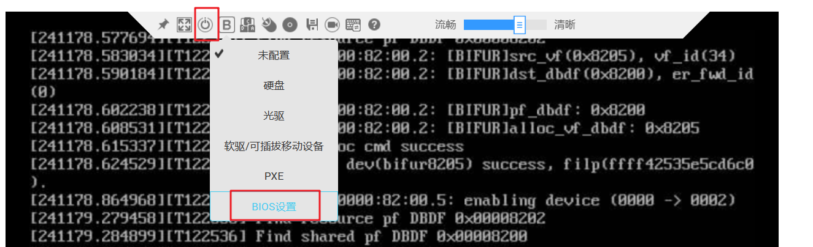
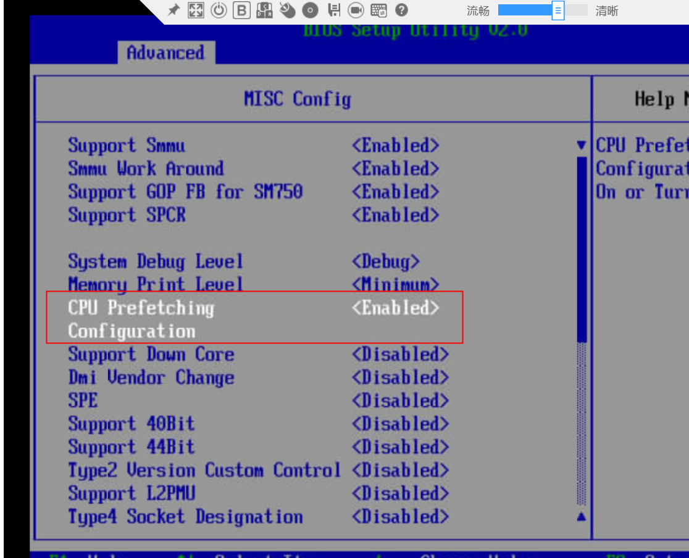
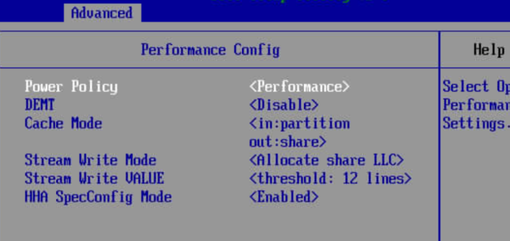
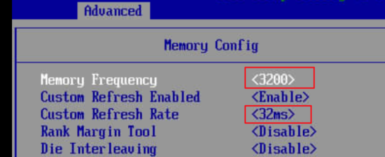

# BIOS调优

介绍服务器BIOS配置的性能调优方法，涵盖CPU预取、电源策略及内存频率等BIOS选项的设置。阅读本指南后，您将能通过BIOS配置提升服务器性能。

1. 进入服务器的BMC（Baseboard Management Controller，基板管理控制器）虚拟控制台，点击“B”按钮->BIOS配置->电源按钮->强制重启。

    

2. CPU预取：等待界面进入BIOS界面后，进入“Advanced”->“MISC Config”页面，移动向下方向键到“CPU Prefetching Configuration”，按回车，将其选为“Enabled”。

    

3. 电源策略：在步骤2界面，按“ESC”回到上一层，进入“Performance Config”页面，移动到“Power Policy”，按回车，将其选为“Performance”。

    

4. 内存配置：在步骤3界面，按“ESC”回到上一层，进入“Memory Config”页面，移动到“Memory Frequency”，按回车，将其选为最大值，例如此处为“3200”，按回车，再移动向下方向键到“Custom Refresh Rate”，按回车，将其选为最小值，例如此处为“32ms”。

    

5. 按“F10”按钮保存并退出。等待服务器重启成功即可。
