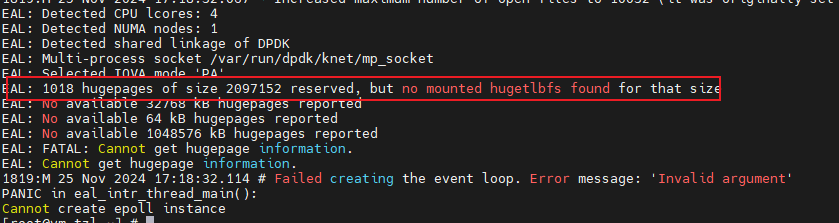

# 内存故障

## 现象描述

找不到挂载大页，启动失败，日志报错为DPDK初始化失败：



## 原因

未挂载大页。

## 处理步骤

1. 参照[配置大页内存](../feature_guide/environment_configuration.md#配置大页内存)确保root用户为系统配置完大页后，当前用户完成挂载大页操作。
2. 查看大页挂载情况。
   
    ```bash
    mount | grep huge
    ```

    回显示例如下，表示成功：

    ```output
    cgroup on /sys/fs/cgroup/hugetlb type cgroup (rw,nosuid,nodev,noexec,relatime,hugetlb)
    hugetlbfs on /dev/hugepages type hugetlbfs (rw,relatime,pagesize=2M)
    hugetlbfs on /home/KNET_USER/hugepages type hugetlbfs (rw,relatime,pagesize=1024M)
    ```
